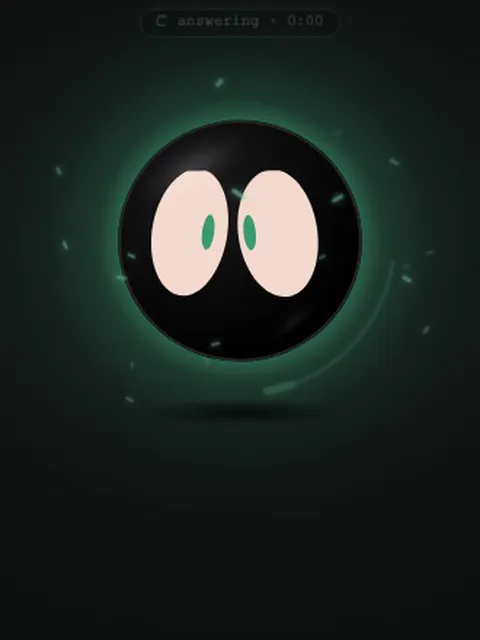
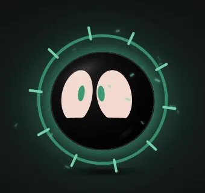

<p align="center"></p>

<h1 align="center">Void</h1>

<p align="center"><b>A little orb that lives on your desktop, listens, and drives <a href="https://docs.anthropic.com/en/docs/claude-code">Claude Code</a> for you.</b><br>
He talks back in a natural local voice, and his eyes show what he's thinking.</p>

<p align="center">
  
  
  
</p>

Say **"hey Void, fix the failing tests"** and he gets to work in your project. He floats on top of everything like a
widget, not an app window, holds up a tiny terminal so you can watch what he's doing, then tells you how it went.

## Meet him

<table>
<tr>
<td align="center" width="50%"><br>
<b>He does the work</b><br><sub>Reads, edits and runs commands on a little terminal he holds like a sheet of paper. A sweat drop while the tests run, then the good news.</sub></td>
<td align="center" width="50%"><br>
<b>He listens</b><br><sub>Say "hey Void", click him, or just keep talking right after he answers. His ring moves with your voice.</sub></td>
</tr>
<tr>
<td align="center"><br>
<b>He reacts</b><br><sub>Happy, love-struck, starry-eyed, surprised, ^&nbsp;^, winking, curious, shy, sad, scared, grumpy, sleepy… His face follows what he's saying, word by word.</sub></td>
<td align="center"><br>
<b>Dress him up</b><br><sub>Cat ears, bunny, bear, antenna, horns, halo, crown, sprout, party hat, headphones, a bow, and any colours you like (two different eyes too).</sub></td>
</tr>
<tr>
<td align="center"><br>
<b>Pet him</b><br><sub>Rub the mouse back and forth over him and he purrs. Click him too much and he dodges.</sub></td>
<td align="center"><br>
<b>He's all yours</b><br><sub>Everything runs on your computer: your mic, the speech recognition and his voice never leave it. He only talks to Claude Code.</sub></td>
</tr>
</table>

Under the hood: the server records the mic itself (PipeWire / Pulse / ALSA), speech-to-text is faster-whisper, the voice
is Kokoro (or piper / espeak-ng as fallbacks), and the server only listens on 127.0.0.1 behind a per-launch token.

## Install

```bash
git clone https://github.com/PLAYER99-void/void.git
cd void && ./install.sh
void
```

The installer handles **Arch**, **Debian / Ubuntu** and **Fedora** (and their relatives) — it installs the system packages
it needs with pacman, apt or dnf, then puts everything else in your home folder (`~/.local/share/void`). On other
distros it tells you which packages to install yourself.

You also need [Claude Code](https://docs.anthropic.com/en/docs/claude-code) installed and logged in (run `claude` once in
a terminal). To update: `git pull && ./install.sh`.

**Bind a hotkey** to `void listen` (pop up and start listening). Also handy: `void look` (screenshot, then listen) and
`void` (show / hide).

| desktop | how |
|---|---|
| Hyprland | `bind = SUPER, A, exec, void listen` in `~/.config/hypr/hyprland.conf` |
| sway / i3 | `bindsym $mod+a exec void listen` in your config |
| GNOME / KDE / XFCE / Cinnamon | Settings → Keyboard → Shortcuts → add a custom shortcut that runs `void listen` |

## Works on

| desktop | what he is |
|---|---|
| **Wayland with layer-shell**: Hyprland, sway, KDE Plasma, river, niri, Wayfire, labwc, COSMIC… | a true overlay, like a bar or a notification: above every app on every workspace, never tiled, no taskbar entry, no window rules needed |
| **GNOME (Wayland)** | GNOME has no layer-shell, so he runs through XWayland as an always-on-top window on every workspace |
| **X11**: i3, bspwm, Openbox, XFCE, Cinnamon, MATE, KDE on X11… | an always-on-top borderless window on every workspace, kept out of the taskbar |

He starts in the bottom-right corner; drag him anywhere and he remembers the spot. To be see-through on a bare X11
window manager (i3, bspwm, Openbox) you need a compositor running, e.g. `picom`.

## Using him

| | |
|---|---|
| **left-click** him | talk; he stops listening when you stop talking |
| **right-click** him | his sparks swirl out into the menu: talk · new chat · folder · history · show my screen · hover · settings · hide |
| hold **Space** | push-to-talk |
| **click** him or tap **Space** while he's working or talking | cuts him off. A click then listens; holding Space lets you talk straight away |
| just **type** | a box pops up under him; **Enter** sends. 📷 attaches a screenshot (right-click it for your clipboard) |
| **drag** him | park him anywhere; he remembers the spot (outside hover mode) |
| **Esc** | close menus → cancel listening → stop Claude → shush → hide |
| say **"hey Void"** | wakes him up (on by default; Settings → Voice). "Hey Void, run the tests" works in one go |

Settings → Look → "Click through around him" lets clicks on the see-through space go to the window behind (off by default).

### Showing him things
- Say "look at my screen", "what's this error on my screen?" or "explain what I copied", and he grabs a screenshot or your
  clipboard and sends it along. You can also use 📷 in the typing box, "show my screen" in the menu, or `void look`.
  He takes just the window you're using (say "my whole screen" for everything) and shrinks it, so a look costs about a
  third fewer tokens.
- **Live view:** say **"watch my screen"** (or `void live`, `/live`) and a green **LIVE** sticker appears on him. While
  it's on, everything you say comes with a fresh picture of your window, so "why is this red?" just works. He only
  opens the picture when your question is about the screen, and nothing at all is sent while you're quiet. Say
  **"stop watching"** to end it; it also turns itself off after 10 quiet minutes (`live_minutes` in the config).
- **He looks by himself when a task needs it:** if you ask "is the build still running?" or "did that fix the
  layout?", he can take a quick look at your window on his own (`void see`) — you'll see him glance with his looking
  face. He only looks during a task that needs it, never in the background, and he can only look: no clicking or typing.
- Screenshots go to `~/.cache/void/shots` (only the last 30 are kept).

### Hover mode
Turn it on in the menu, in Settings → Look, or with `void hover`. **He becomes your mouse cursor**: a small, plain dot
that covers the real pointer, with no sparks or glow so he isn't distracting. His eyes look the way you move. Clicks go
straight through him. On Hyprland the normal pointer is hidden underneath.

**Call him** (`void`, `void listen`, "hey Void", or `void hover` again) and he glides from the cursor back to his spot and
grows back to full size, ready to listen. `void stop` always brings the normal cursor back. Works on Hyprland and X11 desktops.
Other Wayland desktops don't tell apps where the mouse is, so it isn't available on sway or KDE, and on GNOME he only
keeps up while the mouse is over older (X11) apps.

### Asking before he acts (Settings → Brain)
- **Ask me first** (default): he edits files on his own, but before running a command or going online he shows a card,
  asks out loud, and waits. Say "yes", "no" or "always" (no more asking for that command this chat), or click / press
  Y / N.
- **Just do it**: runs anything without asking.
- **Look, don't touch**: reads and explains, changes nothing.
- **Root mode**: like "just do it", plus `sudo` works. When he needs root, a small password card appears right next to
  him (no separate window) — type it and press Enter. Your password goes straight to sudo and is never stored.

### Memory and history
- Say **"remember …"** ("remember my main project is in ~/code/app") and he knows it in every future chat.
  Say "forget …" to drop a note, or "what do you remember?" to see them. You can also edit notes in the 🧠 panel.
- A new chat also gets a short summary of your last few conversations, so he has some context.
- **History** (menu, or **Ctrl+H**) keeps every exchange. Click one to read the full answer, copy it, ask it again, or
  **continue that chat**.

### When a long task finishes
If he's hidden when an answer lands, you get a desktop notification. You can also have him pop back up
(Settings → More).

### His face
- **Pupils:** slits, circles, dots, big circles, hearts and spinning stars. They follow his mood and what Claude is doing.
- **Moods while working:** reading (eyes sweep along lines), editing (concentrated squint), running a command (eyes on the
  terminal, a sweat drop), searching the web (darting around), asking permission (puppy eyes).
- **Other moods:** happy, beaming "^ ^", excited (stars), love (hearts, when you say thanks), shy, wink,
  curious, confused, surprised, scared (trembling pupils), sad (droopy eyes and a tear when something fails), bored,
  annoyed, sleepy.
- **Colours:** pupils and eye whites can be any colour, or random each time he appears.
- **Motion:** he doesn't bob or bounce; all the life is in his eyes.
- **Talking:** he talks like a person, in time with his words: mostly looking at you with small eye movements, glancing
  off to the side while he finds the words, a little nod at the end of a sentence, a head tilt on a question.
- **He means it:** Claude marks how it means each sentence with a little tag (`[proud]`, `[sorry]`, `[unsure]`,
  `[thinking]`, `[curious]`, `[laugh]`, `[warm]`, `[serious]`, `[excited]`, `[surprised]`, `[happy]`, `[neutral]`), and
  his face changes right on that word: a proud "^ ^" when something's fixed, puppy eyes when he's sorry, one brow up when
  he's unsure, looking up and away while he thinks, a giggle when he laughs. The tags are never shown or spoken. (Replies
  without tags, like his quick answers, fall back to reading the words.)

### Things he does instantly (no waiting for Claude)
| say | |
|---|---|
| "volume up" · "set volume to 40" · "mute" | sound (PipeWire / Pulse) |
| "pause" · "next song" · "what's playing" | music, via playerctl |
| "brightness down" | screen brightness, via brightnessctl |
| "timer 10 minutes" · "remind me in 20 minutes to stretch" · "remind me at 5 to call mom" | he pings you, out loud and with a notification |
| "how long is left" · "cancel my timers" | |
| "what time is it" · "what's the date" | |
| "open firefox" | any installed app |
| "lock my screen" | |
| "switch to my blog" | jumps to a project folder. Teach him with "remember my blog is in ~/code/blog", or add it in Settings → Brain |

Everything else goes to Claude. **Settings → Brain → Model → Auto** sends quick chit-chat to the fast model and real work to
the full one.

### When he's working
A bright spark circles him and a pill up top says what he's doing and for how long ("running npm test · 0:12") for as long
as Claude is busy. When he answers, the words appear as he says them.

### The terminal
While he works he holds a small terminal like a piece of paper, just under his eyes, turned to face him, so you see it
from the back (the text reads mirrored and the top leans toward you). It shows what he's really doing: the lines he's
changing (red `-` out, green `+` in), the command he runs and its output, the file he's reading, search hits and his plan.
While he reads, his eyes rest on it and it stays still. Every several seconds he looks away (left, right, up, or at you)
and takes the paper with him. The title says what it is ("editing server.py", "Run the tests") with a ✓ or ✕ when it's
done. In Root mode it wears a red ROOT sticker (on the side you see, so it reads the right way round), and commands get a red border and a `#` prompt. It goes away when he starts answering. It only swings out to a side that has room, so it never runs off the screen
when he's parked in a corner, and it never covers his eyes. Settings → Look → Terminal turns it off, or switches it to
**Faces you (readable)** so you can read along with what he's typing.

### Interrupting him
Say **"stop"** (or "wait", "shh", "be quiet") while he's talking and he stops. Say **"hey Void, …"** mid-sentence to cut in
with something new. Settings → Voice → "Interrupt him by voice".

### Long answers
When an answer is long or has code, a **↗ full answer** button appears under him. It opens the whole thing with proper
formatting and a copy button on every code block.

### His personality
He doesn't chatter: no greetings, no comments about your computer, no pop-ups you didn't ask for. He gets sleepier late
at night. Rub the mouse back and forth over him and he purrs ("^ ^" and little hearts). Click him too many times and he
dodges.

### Skins and colours
Settings → Look:
- **Colours:** tap any part of him in the preview (body, either pupil, either eye white, or his skin) and pick a colour with
  the colour square, the hue slider, a hex code, the swatches or your recent colours. Turn off **Matching eyes** to give him
  two different eyes. **🎲 all** rolls a whole new look; **Surprise me** does it every time he appears.
- **Skins:** cat ears, bunny ears, bear ears, antenna, devil horns, halo, crown, sprout, party hat, headphones or a bow.
  Ears twitch and droop or perk up with his mood, and the antenna and sprout wobble when he moves.
- **Typing:** `/skin cat`, `/body #c9a8f0`, `/eyes pink`, `/whites mint`.

### Sound effects
Soft little blips when he wakes up, opens his menu, finishes a task or reminds you. Settings → Voice → Sound effects.

### Starting up
Void starts when you log in (Settings → More → "Start when I log in"). That's `~/.config/autostart/void.desktop`, which
GNOME, KDE, XFCE, Cinnamon and MATE pick up; on Hyprland it also adds a marked `exec-once` line to `hyprland.conf`.
Turning the setting off removes both. On sway / i3 / other bare window managers, add `exec void show` to your config. He's listening
for "hey Void" straight away. Turn on Settings → Voice → "Listen as soon as he pops up" if you want `void` to start
listening immediately too.

### When he's just hanging out
Every few seconds of quiet he does a little routine: looks around, rolls (the whole ball, or just his eyes), yawns, chases
one of his sparks with his eyes, hums and sways, peeks, stretches, whistles, gets a bit dizzy, shakes it off, or blinks a
few times. Move the mouse over him and he stops to look at you.

## Commands

`void` (show/hide) · `void listen` · `void look` · `void live` · `void see` · `void hover` · `void doctor` (mic check) · `void stress` (voice stutter test) · `void render default|nodmabuf|nocomp` (how he's drawn) · `void restart` · `void stop` · `void log`

In the typing box: `/new` `/cd <dir>` `/history` `/memory` `/remember …` `/forget …` `/look` `/clip` `/hover`
`/model <opus|sonnet|haiku>` `/voice` `/eyes <colour|random>` `/whites <colour|random>` `/pupils <slit|circle|dot>` `/mute` `/stop`

## Config: `~/.config/void/config.json`

Almost everything is in Settings. A few extras:

| key | default | |
|---|---|---|
| `trust` | `ask` | `ask`, `trust` or `readonly` (see above) |
| `wake_word` | `true` | "hey Void" |
| `autostart` | `true` | start when you log in |
| `listen_on_show` | `false` | start listening as soon as he pops up |
| `barge_in` | `true` | say "stop" while he talks |
| `follow_up` | `4` | seconds after he stops talking that he still hears you without "hey Void" (`0` = off) |
| `sfx` | `true` | sound effects |
| `look` | | body / pupils / whites / skin (set in Settings → Look) |
| `projects` | `{}` | name → folder, for "switch to …" |
| `model` | `""` | `auto`, `opus`, `sonnet`, `haiku` |
| `hover` | `false` | float next to the cursor |
| `tts` | `auto` | voice engine: `auto` (Kokoro, then piper, then espeak), `kokoro`, `piper`, `espeak`, `off` |
| `voice` | `girl` | girl, cute, guy, deep, british, story, robot (Settings → Voice) |
| `kokoro_voice` | | any Kokoro voice id, e.g. `af_sky`, `am_puck`, `bf_emma` — overrides the preset |
| `whisper_model` | `auto` | `small.en` on an NVIDIA GPU, `base.en` on CPU; or `tiny.en` / `medium.en` |
| `stt_hint` | coding words | words he should expect (add your project names) |
| `mic_device` | `""` | input to record from (Settings → Voice lists them) |
| `extra_args` | `[]` | extra CLI flags for `claude` |

Memory lives in `~/.local/share/void/memory.json` and history in `~/.local/share/void/history.jsonl`. Both are plain files
you can read or delete.

## Other ways to run him

`VOID_NO_LAYER=1 void` skips the overlay and uses a normal always-on-top window. `VOID_BROWSER=1 void` opens him in a
plain browser app window instead (handy if WebKitGTK misbehaves).

## Troubleshooting
- **He doesn't stay on top / looks like a normal window:** run `void doctor` — the first lines say whether he's an
  overlay here and why not. Check `gtk-layer-shell` is installed (Debian/Ubuntu: `gir1.2-gtklayershell-0.1`). If he
  can't be an overlay he uses XWayland instead, so XWayland needs to be available too.
- **His face and his voice run on separate CPU cores** (on computers with 4+ cores): the window gets the first half,
  the voice/brain the second half, so drawing him can never starve his voice. `"cpu_split": false` turns that off.
- **Speech stutters:** run `void stress`. He says a few sentences four times — on a quiet computer, with every CPU core
  flat out, with Void itself busy, and with both — and it tells you if the voice ever ran dry and how close it came.
  His voice is played by the server straight to PipeWire/Pulse (not the window), the next sentences are made while the
  current one plays, and almost a second of sound is kept buffered, so a busy moment can't cause a gap. If the test says
  your voice is too slow for the computer, pick a lighter one. (`"voice_out": "page"` in the config plays it in the
  window instead, like older versions.)
- **He can't hear you:** run `void doctor`. It lists your inputs, records 3 seconds and shows a level meter. Pick the right
  mic in Settings → Voice.
- **He flashes and disappears:** WebKit is crashing on your GPU driver (common on NVIDIA + Wayland). The launcher retries
  with safer render modes and remembers the one that works. Pick one yourself with `void render nocomp` (steadiest on
  NVIDIA), or reset with `void render default`.
- **Black box around him:** nothing is doing transparency. On a bare X11 window manager start a compositor (`picom`).
- **"not allowed: Bash":** you're on "Look, don't touch". Switch it in Settings → Brain.
- **Screenshots fail:** install `grim slurp` (Hyprland, sway and other wlroots desktops), `spectacle` (KDE),
  `gnome-screenshot` (GNOME) or `maim` (X11). For the clipboard, install `wl-clipboard` or `xclip`.
- Logs: `void log`.

## License

[MIT](LICENSE)
